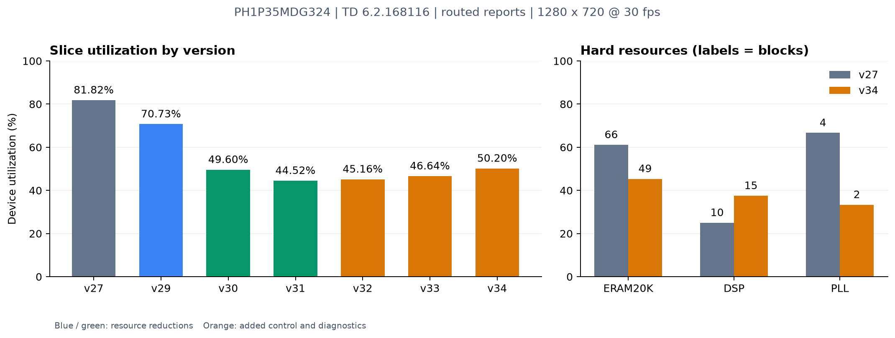

# v27 与当前 v34 资源使用及优化报告

日期：2026-10-13。范围：cvp 相机主板 `08_csi_dsi_cs500_7cun`，当前版本为 **v34 PID 与数字增益候选**；HDMI_OUT 子板不计入本报告。

## 结论

当前版本相对 v27 **净减少 6709 Slice（38.65%）、5892 LUT6（40.79%）、9318 FF（46.61%）和 17 块 ERAM（25.76%）**。Slice 占用率从 81.82% 降到 50.20%，下降 **31.62 个百分点**；PLL 从 4 个降到 2 个。PID 与数字增益使 DSP 从 10 个增加到 15 个。

收益来自两类工作：统计、状态传输及算法的实现优化，以及本地 DDR/DSI 显示功能的裁剪。DDR/DSI 裁剪是最大的单阶段收益，不能把所有节省都描述为功能不变。后来增加的 AE 平滑、错误恢复和 PID 用回一部分逻辑资源，仍保留明显净收益。

**当前资源空间增加，但时序余量缩小。** v34 最坏建立裕量只有 +0.015ns，v27 为 +0.107ns。下一步优先改善 PID 控制链时序，然后考虑帧级乘法复用及缓存压缩。v34 已仿真和布线通过，尚无本次候选的上板验收记录。

## 1. 数据来源与比较口径

两端均采用 **PH1P35MDG324、TD 6.2.168116、1280×720@30fps 的布线后报告**；未把综合预估 Slice 与布线结果混用。v27 是发布构建，v34 是当前候选构建。当前工作区 187 个 HDL 文件原始字节 SHA256 与 v34 manifest 全部一致；七个阶段的资源及时序报告均按各 manifest 的规则校验通过。

主数据来自 [v27 原始资源报告](../../releases/v27/resource_report.txt)、[v27 时序报告](../../releases/v27/timing_report.txt)、[v34 原始资源报告](../../releases/v34-candidate/resource_report.txt)、[v34 时序报告](../../releases/v34-candidate/timing_report.txt)。完整提取数据和哈希见 [JSON](v27_v34_assets_20261013/resource_metrics.json)，可供表格处理的版本数据见 [CSV](v27_v34_assets_20261013/resource_comparison.csv)。

**历史文档差异已统一：** v29 的说明表引用 v27 LUT6=14455、FF=19999，但正式 `releases/v27/resource_report.txt` 为 **14443、19992**。本报告采用正式 v27 文件，因此 v27→v29 的 LUT6/FF 差值是 -1699/-4530；不会与历史说明中的 -1711/-4537 混用。

## 2. v27 与 v34 总资源比较

“数量变化百分比”以 v27 已使用数量为分母；与占用率的百分点变化不同。FF、LUT 与 Slice 属于不同统计层次，不能相加为总资源。

| 资源 | v27 | 当前 v34 | 数量变化及相对变化 |
|---|---:|---:|---:|
| Slice | 17359 / 21216（81.82%） | 10650 / 21216（50.20%） | -6709（-38.65%） |
| LUT6 | 14443 / 21216（68.08%） | 8551 / 21216（40.30%） | -5892（-40.79%） |
| FF | 19992 / 42432（47.12%） | 10674 / 42432（25.16%） | -9318（-46.61%） |
| ERAM20K | 66 / 108（61.11%） | 49 / 108（45.37%） | -17（-25.76%） |
| DSP | 10 / 40（25.00%） | 15 / 40（37.50%） | +5（+50.00%） |
| PLL | 4 / 6（66.67%） | 2 / 6（33.33%） | -2（-50.00%） |
| DDR byte | 6 / 12 | 0 / 12 | -6 |
| MIPI TX | 1 / 2 | 0 / 2 | -1 |
| MIPI RX | 1 / 2 | 1 / 2 | 保留 |
| F7 / F8 mux | 96 / 41 | 16 / 1 | -80 / -40 |
| IO 报告统计 | 70 / 160 | 32 / 160 | -38 |

IO 统计减少主要对应被裁掉的支路；板卡实际引脚接线没有因此改变，也不能据此推导功耗。DDR/MIPI TX 资源未使用对应主板 DSI 屏关闭，ETHA 收图及 ETHB 到 HDMI_OUT 子板的镜像仍保留。

| 可用资源余量 | v27 | v34 | 变化 |
|---|---:|---:|---:|
| Slice | 3857 | 10566 | +6709，约为原余量 2.74 倍 |
| ERAM20K | 42 | 59 | +17 |
| DSP | 30 | 25 | -5 |
| PLL | 2 | 4 | +2 |

这些数量只是静态预算。后续分类器/LeNet 是否能够接入，还取决于 DSP、RAM 端口、数据吞吐、布局布线和时序，不应只按空闲 Slice 数量承诺。

## 3. 优化与功能增加的阶段账目

| 版本 | Slice | 相对前一阶段 | LUT6 | FF | ERAM / DSP | 主要原因 |
|---|---:|---:|---:|---:|---:|---|
| v27 | 17359（81.82%） | — | 14443 | 19992 | 66 / 10 | 对比基线 |
| v29 | 15006（70.73%） | -2353 | 12744 | 15462 | 65 / 10 | 直方图/状态桥/元数据优化，移除周期 UART 诊断 |
| v30 | 10523（49.60%） | -4483 | 8484 | 10304 | 51 / 10 | 裁掉本地 DDR→DSI 显示支路 |
| v31 | 9445（44.52%） | -1078 | 7613 | 9837 | 49 / 10 | 卡通中值窄化、tone 精确查表、RAW 旁路注册修复 |
| v32 | 9582（45.16%） | +137 | 7742 | 9990 | 49 / 10 | 四帧 AE 平均、两帧等待及小步长 |
| v33 | 9895（46.64%） | +313 | 7942 | 10219 | 49 / 10 | 流错误恢复、完整帧检查和来源诊断 |
| v34 | 10650（50.20%） | +755 | 8551 | 10674 | 49 / 15 | PID、曝光优先数字增益及写入/帧同步保护 |

v27→v31 累计减少 **7914 Slice**；v31→v34 的控制及诊断功能增加 **1205 Slice**，最终净减少 **6709 Slice**。DDR/DSI 裁剪的 4483 Slice 约占前三个减资源阶段总削减的 **56.6%**。阶段差值包含重新映射和打包变化，不能直接拆成每一处代码改动的独立收益。

### v29：改变存储方式，减少寄存器和宽选择器

- 32×20bit 直方图与快照从 FF 阵列改为分布式 RAM，统计走查直接读取；通过消隐期旋转清扫维持帧间初始化。降低宽多路选择和读增写的逻辑开销。
- 状态跨时钟域原先保留多份 1536bit 寄存器，改为双 bank ERAM 快照及串行读取；保留线上字节序、快照原子性与发送握手。
- 帧元数据队列改为单 pending 寄存器，在正常完整帧和现有消隐契约下保持元数据捕获与 overflow 行为；减少低利用率 ERAM。
- 纯数据流水去掉不必要的异步复位，控制与 valid 保留复位。单独记录的收益仅 **47 Slice**，不应把其作用夸大。
- 移除周期 CAM/ISP UART 诊断，改用 UDP 状态诊断。历史记录约减少 **1337 FF**，这是诊断接口取舍，并非所有功能完全不变。

该阶段整体实测 -2353 Slice、-1699 LUT6、-4530 FF、-1 ERAM，DSP 不变。来源：[V29 优化说明](../V29优化说明.md)、[v29 发布说明](../../releases/v29/README.md)。

### v30：裁掉 DDR→DSI 末端显示支路

保留通路不消费该支路的输出，删除本地主板显示链的 12 个根实例；保留相机、ISP、网口、ETHB 镜像等 14 个实例连接。整体节省 **4483 Slice、4260 LUT6、5158 FF、14 ERAM、2 PLL、6 DDR byte 和 1 MIPI TX**。主板 7 寸屏不能再由此工程驱动，PC 和 HDMI_OUT 子板显示保留。

这是最大的资源收益，也有明确的功能范围变化。来源：[依赖与裁剪说明](../V30网络输出与DSI裁剪说明.md)、[v30 构建记录](../../releases/v30-candidate/README.md)。

### v31：在既有输出精度内缩小算法

卡通最终只使用每通道高 3 位，中值 min/max 网络也按 3 位处理，默认通用 8 位实例保留；量化与 min/max 的单调关系保证该模式的最终像素保持一致。编译器同时移除了邻域无用低位，风格窗口 ERAM 12→10。tone 的常数分子除法改为精确查表，保留旧完成延迟和 SOF 系数提交时刻，没有新增 ERAM。

主路径已经使用的 DPC BYPASS 四拍延迟被内置到 `cvp_proc`，解决源文件注册反复丢失的问题；这主要是构建可靠性修复，不应另计为裁掉一个正在处理坏点的大模块。整体实测 **-1078 Slice、-871 LUT6、-467 FF、-2 ERAM**。来源：[v31 差分和构建记录](../../releases/v31-candidate/README.md)。

### v32～v34：为控制质量和可靠性增加资源

v32 加入四帧 AE 平均、传感器桥忙状态结束后的两帧等待和小步长，增加 137 Slice；旧控制器仅观察忙状态，没有成功/失败提交反馈。v33 增加完整帧验证、两帧健康恢复和历史错误来源，增加 313 Slice，解决历史错误永久锁存而由 GUI 持续置黑的问题。这些行为有意变化，不属于逐拍等价优化。

v34 帧级 PID 先分配曝光，曝光上限后使用 1～4 倍数字增益；模拟增益保持手动值。默认 PI（D=0），保留限幅、积分保护、写失败保护、请求序号及 SOF 提交机制。相对 v33 增加 **755 Slice、609 LUT6、455 FF、5 DSP**，ERAM 不增加。

新增 5 DSP 的来源可由 v33/v34 综合层级确认：**AE 的两个乘法占 2 DSP，三通道 WB×数字增益占 3 DSP**；原像素增益 3 DSP、统计 2 DSP、tone 4 DSP、MAC 1 DSP 保持不变。总计 2+3+3+2+4+1=15。来源：[v33 综合层级快照](v27_v34_assets_20261013/v33_hierarchy_area.txt)、[v34 综合层级快照](v27_v34_assets_20261013/v34_hierarchy_area.txt)、[v34 实现记录](../../releases/v34-candidate/README.md)。层级父项含子项，不能重复加总。

## 4. 当前资源主要用在哪里

下表是 **v34 综合层级**，用于定位模块；logic LUT/ripple/seq 不是最终 LUT6/FF/Slice，不能用它们替代第 2 节的布线数据。

| 主要模块 | logic LUT | ripple | seq | ERAM | 判断 |
|---|---:|---:|---:|---:|---|
| 风格与增强轮廓（含子模块） | 1994 | 379 | 2598 | 22 | 最大图像算法缓存组 |
| 帧统计（含亮度与除法） | 1037 | 541 | 1060 | 0 | 计数、累加与判定逻辑仍较大 |
| 网络（含 FIFO、状态桥、MAC） | 830 | 90 | 1687 | 18 | 主要消耗弹性缓存与像素 FIFO |
| AE PID | 450 | 248 | 546 | 0 | 当前最紧时序路径，新增 2 DSP |
| RAW 分组跨域 | 27 | 24 | 100 | 5 | 输入跨域缓冲 |
| RAW 处理/去马赛克 | 319 | 103 | 346 | 4 | 邻域行缓存与流水 |

49 块 ERAM 的分配为：**风格 22（基础窗口 10＋增强轮廓 12）、网络 18（像素 FIFO 13＋字节缓冲 4＋状态 1）、RAW 分组 5、去马赛克 4**。PID 为 0 ERAM；四帧平均仅保存统计标量，不是保存四幅图像。主要 ERAM 继续集中在图像邻域和跨域缓冲。

## 5. 时序与验证状态

| 指标 | v27 | v34 |
|---|---:|---:|
| Setup WNS | +0.107ns | +0.015ns |
| Setup TNS | 0 | 0 |
| Hold WNS | +0.020ns | +0.022ns |
| Hold TNS | 0 | 0 |

当前最坏路径是 **`advanced/ae/window_mean[4] → mult1.y[8]`**，100MHz 时钟下有 12 级逻辑，数据延迟 9.667ns，其中 cell 3.957ns、net 5.710ns，布线约占 60%。因此资源减少并没有自动带来更大的频率裕量；应针对 PID 组合链分段，而不是放宽原视频时钟。原报告摘录见 [关键路径](v27_v34_assets_20261013/v34_critical_path_excerpt.txt)。

- **v27 板级记录**：七模式轮换，AE/AWB 开启，300.2 秒、8996 帧，平均 29.965fps、完整率 100%，未报告流/I2C 错误。DSI/HDMI、Flash 冷启动及两光源色卡精度不在该验收范围。
- **v30/v31**：有用户后续上板功能无误的反馈。v31 自身发布说明尚写“未上板”，但后续 v32 的基线记录已注明用户验证 v31；这属于用户反馈，未附正式逐项压力清单。
- **当前 v34**：35 RTL、2 组包完整性、37 Python 测试通过；实际 PID/统计/I2C/帧同步视频链路仿真 460 帧；增益检查 100001 样本，包含 25075 个数字增益 1 倍的新旧逐拍一致样本。当前 187 个 HDL 与构建快照一致，已生成候选比特流，**尚待上板**。
- “暗场 47 帧对 255 帧”比较的是 v34 与 **冻结 v33 的独立光照模型**，不能描述为相对 v27 实机速度提升；AE 新策略也不与 v27 输出逐拍等价。

本次报告只读取文件和生成统计/图表，没有修改 RTL，没有重跑 FPGA 构建，也没有写入开发板。没有功率、温升或整机内存带宽测量，不能据静态资源比例声称功耗同比下降。

## 6. 后续优化顺序

以下均为建议，未实施、未计入已实现收益。若保持七模式和现有功能，优先考虑前五项；实际收益需要独立构建后比较。

| 优先级 | 建议 | 预期方向 | 必须验证的边界 |
|---|---|---|---|
| 1 | 进一步寄存 PID 误差、积分限幅、修正及 DSP 输入/使能 | 优先改善 +15ps 时序；可能增加少量 FF | 六帧节奏不变，失败/取消/手动抢占与积分提交一致 |
| 2 | 复用帧级乘法器 | 三通道系数预计算理论可由 3 DSP 合为 1；AE 两次乘法也可复用。净值未实测 | SOF 前准备，ACK 后提交，首像素与全帧系数一致；像素域保持每拍吞吐 |
| 3 | AWB 区域计数改阈值饱和 | 1280×720 下只比较阈值 460，可用 9bit 饱和表示；四区名义少 44 FF | EOF 最后像素跨阈值、SOF 清零、参数化 W/H、异常超长帧；不能直接截断 |
| 4 | 按参数收窄其他统计标量 | 正常帧计数 20bit、8bit 像素累加 28bit 已足够；候选降低宽加法和寄存器 | 对异常帧采用明确饱和/错误处理，外部 32bit 状态接口补零，除法及比较一致 |
| 5 | 像素 FIFO 将重复 frame_id 移入帧描述符 | 当前 129bit×2048 使用 13 ERAM，有位宽压缩空间；需新构建确认 | 像素/描述符原子接收、FIFO 满、丢帧/恢复、SOF 配对、GMII 排空 |
| 6 | 先增加水位观测，再按最坏突发调整缓存深度 | 优先针对风格 22 ERAM 和网络 18 ERAM | 满分辨率、短消隐、异步时钟偏差、连续帧及轮廓排空；不能只按平均带宽减深度 |
| 可选 | 编译期裁掉确实不用的风格/轮廓功能 | 可释放相关实例资源，但属于功能取舍 | 保留模式输出、协议模式编号和 GUI 行为；净收益需实际配置构建 |

不建议继续大范围取消复位：此前单独收益只有 47 Slice，当前应优先查控制使能/打包和关键组合链。运行时关闭某个图像模式或 AE 主要降低活动率，不会释放已经实例化的 FPGA 硬件。旧 ISP/DDR 源文件留在磁盘但不参与有效实现，删除文件本身也不会继续释放资源。

## 可核查文件

- [v27 构建清单](../../releases/v27/manifest.json)、[v34 构建清单](../../releases/v34-candidate/manifest.json)。
- 各阶段资源：[v29](../../releases/v29/resource_report.txt)、[v30](../../releases/v30-candidate/resource_report.txt)、[v31](../../releases/v31-candidate/resource_report.txt)、[v32](../../releases/v32-candidate/resource_report.txt)、[v33](../../releases/v33-candidate/resource_report.txt)。
- 控制/可靠性说明：[v32](../../releases/v32-candidate/README.md)、[v33](../../releases/v33-candidate/README.md)、[v34](../../releases/v34-candidate/README.md)。
- 图表：[PNG](v27_v34_assets_20261013/resource_usage.png)、[SVG](v27_v34_assets_20261013/resource_usage.svg)；原始提取：[CSV](v27_v34_assets_20261013/resource_comparison.csv)、[JSON](v27_v34_assets_20261013/resource_metrics.json)。
