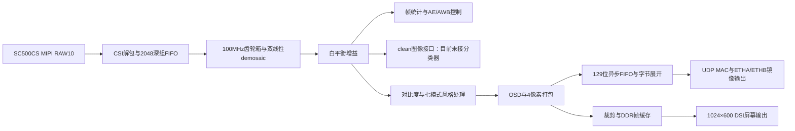

# v29 主板资源占用架构审阅

日期：2026-10-12。范围：PH1P35MDG324 主板相机工程，1280×720@30fps。结论来自当前 RTL 和 `old/releases/v29/resource_report.txt`、`timing_report.txt`；本次没有修改 RTL，也没有重新综合或上板。

当前 160 个源文件的归一化 SHA256 全部与 v29 manifest 一致，可以将发布资源报告用于本次源码分析。下文的“当前占用”是报告实测值，“可节省”属于候选方案估算，不能直接相加作为新版本结果。

## 架构与资源基线

| 资源 | v29 当前占用 | 剩余 |
|---|---:|---:|
| Slice | 15006 / 21216，70.73% | 6210 |
| LUT6 | 12744 / 21216，60.07% | 8472 |
| FF | 15462 / 42432，36.44% | 26970 |
| ERAM20K | 65 / 108，60.19% | 43 |
| DSP | 10 / 40，25% | 30 |

Slice 比 LUT/FF 的单项比例更紧，需关注加法进位、控制集和实际打包。层级报告的 `logic lut`、`ripple`、`seq` 不能直接当作 Slice 相加；父模块包含子模块，统计时不能重复累加。

主要热点：

| 模块或支路 | logic LUT | ripple | FF | ERAM |
|---|---:|---:|---:|---:|
| advanced 整体 | 4609 | 1468 | 6575 | 24 |
| 其中 style 整体 | 2390 | 379 | 2884 | 24 |
| 其中卡通中值 med | 822 | 0 | 413 | 0 |
| 其中 stats | 756 | 541 | 1069 | 0 |
| 网口 u_eth_dbg | 871 | 90 | 1525 | 18 |
| DDR 控制器 wrapper | 2591 | 111 | 3437 | 0 |

DDR 控制器本身的 ERAM 是 0；显示缓存的 ERAM 在 video_in、video_out 和命令队列等外部模块中。全工程 ERAM 可分解为：风格窗口 24 + demosaic 4 + 网络 18 + RAW组FIFO 5 + 显示支路 14 = 65。

## 优先候选：保持现有主要功能

### 1. 卡通中值滤波改为每通道 3 位运算

位置：`advanced/cvp_style.v:35`、`:57`，`advanced/cvp_fx_median.v`。

当前对 RGB 三个通道进行 8 位比较归约，最终 `quantized` 仅使用每通道高 3 位，并扩展成 8 位。可先将窗口的每个通道截取为高 3 位，再执行相同的 min/max/med3 比较网络，最后按现有公式扩展。

理由：单调映射 `Q(x)=x>>5` 与 min/max 运算可交换，因此由 min/max 组成的整个网络满足 `Q(F(x))=F(Q(x))`。不依赖这个网络是否等同于完整九数排序中值。最终卡通 RGB 可逐位保持一致。

该实例当前占 822 logic LUT、413 FF，值得作为第一项 LUT/Slice 优化实验。不能按 3/8 比例承诺综合收益，工具可能已消除部分低位数据。

验证：本次以固定随机种子核对 100000 组单通道九点窗口，最终扩展结果全部一致。这是算法关系检查，不是修改后的 RTL 验证。实施时保持四级流水与 valid/SOF 对齐，并跑新旧 RTL 差分、卡通模式与帧间切换测试。

### 2. 帧号改为每帧传递一次

位置：`net/cvp_eth_dbg.v:150`。

像素跨域 FIFO 目前为 2048×129bit：96bit RGB + 1bit SOF + 32bit frame_id，占 13 块 ERAM。帧号在一帧内恒定，每四个像素重复存储一次，额外逻辑容量为 65536bit。

建议：主 FIFO 保留 97bit；源端 SOF 时将完整 32 位帧号送入独立浅异步描述符队列，目的端消费 SOF 时取对应帧号并保持到下一帧。按当前 2048 深度的映射规律，主 FIFO 可能由 13 块降至约 10 块；扣除描述符队列后，净收益约 2～3 块 ERAM，需 TD 实测。

不能直接使用现有 `frame_descriptors` 替代：它在 GMII 域中、位于当前像素 FIFO 之后。必须重新处理源端帧号的跨域和顺序对应。描述符与像素需要联合容量保证、溢出恢复和帧首配对，不能将帧号降为低 8 位来省资源。

### 3. 窗口入口队列按实际帧间消隐重新定深度

位置：`common/cvp_window3x3.v:5`、`:15`。

全工程有六个相关窗口，全部默认 FIFO_AW=11，即 2048 深。窗口共占 28 块 ERAM，其中入口 queue 合计 10 块：风格 RGB+luma 4、demosaic 2、轮廓四级各 1。剩下 18 块用于行缓存。

queue 的重要用途是吸收帧底排空时的新输入，不能将它们视为无用缓存。对于真实相机链路，如果能证明每一级 EOF 后到下一帧到达的最短消隐覆盖其排空与上游残留，便可把相应实例改成较浅队列，保持原接口和读延迟。

先记录每个队列的最大水位，再做 full-resolution 最短消隐、随机 valid 空洞、连续帧、级联排空测试。浅队列若映射到 LUTRAM，可释放其中若干 ERAM；理论上入口队列相关的上限是 10 块，但这是上限，不是已验证可全部移除的收益。需要权衡新增 LUT/FF。

同样可扫描网口像素 FIFO 的 PXF_AW=11→10：当前 129bit 宽度下预计从 13 块降至约 7 块，但必须先证明突发水位。该收益与上一项帧号剥离存在重叠，不能直接相加。

源码的“24bit像素FIFO”“97bit”“0～200水位”“40.2MHz”等注释混有旧版本描述；当前实际是 129bit 四像素数据字、100MHz→125MHz，发布时序报告的 MIPI_RX_BYTE_CLK 为 112.511MHz。定深度应依据当前 RTL 和实测时序。

### 4. 对比度系数用精确小查表替代通用除法器

位置：`advanced/cvp_tone.v:10`。

tone 的除法只计算 `floor((224<<8)/(white-black))`，再限幅至 128～512。有效跨度是 25～255，最多 231 个输入值。可使用精确常量表或专用窄位宽除法，替代 32 位通用 divider。其当前 divider 占 94 logic LUT + 32 ripple、147 FF。

本次检查了全部合法跨度的计算范围。实施时还须验证表内容、低跨度旁路、黑点偏移，以及 pending_gain 在下一 SOF 的应用时机；不能只保证最终数值而忽略旧实现的完成延迟。若表映射为 ERAM，需明确这是用少量 ERAM 换 LUT/FF。

### 5. 统计累加器和控制集适度收窄

位置：`advanced/cvp_frame_stats.v:37`、`:41`，`advanced/cvp_fx_median.v`。

正常 720p 帧中：像素数最大 921600，需要 20bit；8bit通道累加和最大 235008000，需要 28bit；四分区各最多 230400 个像素，需要 18bit。当前不少统计量用 32bit，区域计数用 20bit，存在窄化空间。

但统计模块也接收异常流；直接缩小计数器会改变超长帧的回绕与错误判据。实施前必须补饱和或独立错误检测，并维持对外 32 位状态字段和除法精度。收益属于较小的 LUT/FF 优化。

中值滤波内部还有按 valid 分级门控的宽数据寄存器。可以做数据无条件打拍、valid 单独控制的实验，比较 TD 的 Slice 打包；v29 已记录摘异步复位只省 47 Slice，不应继续把“统一去复位”当作主要收益来源。去 CE 还会增加无效周期的翻转，需要同时考虑功耗。

## 最大收益方案：编译时关闭主板 DSI 显示

位置：`design_top_wrapper.v:518`～显示发送链路。

主板已从同一 MAC 镜像发送 ETHA/ETHB，子板能承担 HDMI 显示。如果产品只要求 PC 收图和子板 HDMI，可增加编译参数，整体裁掉主板 96→128bit 转换、裁剪、DDR 写读、DDR 控制器、DSI 时序/配置/发送链路。

该支路 12 个不重叠顶层实例的当前占用合计：3545 logic LUT + 368 ripple、5174 FF、14 ERAM、2 PLL、6 DDR byte 资源，另有 296 DRAM LUT 和 32 shifter LUT。这是当前支路规模，不是已经实现的删除收益；共享诊断、端口和工具重新映射会影响最终数字，也不能换算成精确 Slice。

此方案会失去主板 7 寸屏显示。运行期将屏幕关闭不会自动释放硬件，必须是编译时 generate/独立顶层裁剪。建议保留完整构建和纯网络构建两个配置。

显示保留时还需先核查现有时钟连接：`rgb_frame_crop` 的输入来自 100MHz 转换器，却在顶层连接 S_csi_rx_clk，输出又被 100MHz video_in 接收。RTL 中没有可见的正确 CDC。v29 manifest 的 dsi_verified=false；不能仅根据 WNS 为正判定这条支路已通过功能验证。

## 不建议投入的方向

- 删除磁盘上的旧 ISP/UART 文件：未例化或被综合排除的源码不占硬件资源。
- 把运行期 mode 选择改成普通 if/case 就期待硬件消失：七种模式仍需同时存在，门控主要减少活动功耗。
- 认为 ETHB 有第二套 UDP/MAC：顶层已复用同一发送链，删除 ETHB 主要影响 IO。
- 为了减位宽直接将 style 的 32bit RGB+luma 行缓存改为 24bit：Sobel 仍需邻域亮度，重新计算多个窗口像素会增加逻辑，须比较完整代价。
- 直接删除基础 Sobel：模式 4 的卡通描边仍使用它；v27 contour 则服务模式 3/5，二者输出算法和延迟不同。
- 从通用 patch_bridge 省资源：当前 clean 输出未接分类核心，patch_bridge 并未出现在此构建的层级资源报告中。
- 单纯继续将所有常数乘法改成移位加法：本工程很多地方已经如此，DSP 仍余 30 个；需要按分类器最终预算决定资源取舍。

## 建议实施顺序与验收

保留全部功能时：先做卡通 3 位中值，再做帧号元数据分离和 tone 专用系数生成；窗口/FIFO 定深度在记录最坏水位后实施。若决定主板无需 DSI，优先做编译时显示裁剪，再重新统计其余优化的必要性。

时序最紧路径在 `advanced/stats/rr` 到 `regions_snap`，经过中性像素筛选和区域计数判断，setup WNS 仅 +0.102ns；hold WNS +0.020ns。统计路径优化应同时评估流水、数据/EOF对齐和时序，不建议拉长组合路径来换 FF。

每项独立形成可对比构建：有效像素逐位差分 + 帧号/配置/首末行列断言 + UDP线上包与CRC + 最坏FIFO水位 + TD综合/布线资源和setup/hold。正常画面帧间隙不足以代表所有允许输入，放宽或收紧接口假设要写进模块契约。

本次仅完成源码和报告审阅、源哈希核对、卡通量化数学关系随机检查以及 tone 输入域范围检查。v29 的 22 项历史 RTL 回归来自发布记录，本次没有重跑；没有对任何候选方案宣称综合收益或板级验收。
